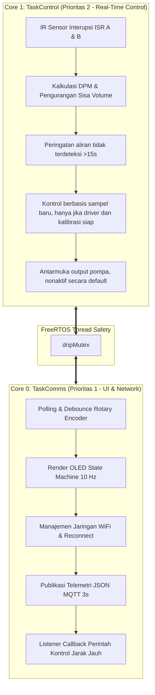

# Smart IV Drip Monitor (Dual-Channel) - Firmware ESP32

[](https://platformio.org/)
[](https://www.espressif.com/en/products/socs/esp32)
[](https://www.freertos.org/)
[](https://mqtt.org/)
[](https://github.com/adafruit/Adafruit-GFX-Library)
[](LICENSE)

**Smart IV Drip Monitor (Monitis)** adalah prototipe riset nonklinis berbasis **ESP32 Dual-Core** untuk memantau dua channel tetesan dengan sensor IR, OLED, rotary encoder, dan MQTT. Peralihan ke pompa peristaltik DC masih berupa antarmuka software: model motor/driver, pinout, dan data kalibrasi belum ditentukan, sehingga firmware saat ini menonaktifkan output pompa dan menolak aktivasi `RUNNING`.

---

## 📌 Daftar Isi
- [Latar Belakang & Fitur Utama](#-fitur-utama)
- [Arsitektur Sistem FreeRTOS](#-arsitektur-sistem-freertos)
- [Skema Rangkaian & Pinout Hardware](#-skema-rangkaian--pinout-hardware)
- [State Machine UI Display](#-state-machine-ui-display)
- [Spesifikasi Komunikasi & Format JSON MQTT](#-spesifikasi-komunikasi--format-json-mqtt)
- [Struktur File Kode Sumber](#-struktur-file-kode-sumber)
- [Panduan Instalasi & Penggunaan](#-panduan-instalasi--penggunaan)

---

## 🚀 Fitur Utama

1. **Dual-Channel Monitoring (1 ESP32 $\rightarrow$ 2 Ranjang Pasien)**:
   - Memantau laju tetesan (**Bed 1** & **Bed 2**) secara simultan dan independen.
   - Estimasi DPM dari waktu antar-tetesan sensor inframerah; nilai ditandai belum valid sebelum tersedia interval dan menjadi kedaluwarsa jika tidak ada tetesan baru.
   - Pelacakan dan kalkulasi sisa volume cairan infus (faktor tetes: 20 tetes/ml).

2. **Antarmuka kontrol pompa peristaltik (dinonaktifkan secara default)**:
   - Target DPM dikonversi nominal ke ml/jam dengan `target_DPM * 60 / dropFactor`. Konversi ini bergantung pada faktor tetes yang benar dan bukan pengukuran volume langsung.
   - `PumpOutputDriver` memisahkan kontrol dari hardware; backend wajib menyediakan profil batas aliran dan PID serta pemetaan aliran-ke-perintah yang dikalibrasi di bench.
   - `PUMP_OUTPUT_ENABLED` bernilai `0`, tidak ada backend, pin motor, frekuensi PWM, polaritas, batas arus, maupun tabel kalibrasi yang dipilih. Karena itu tidak ada perintah motor dan MULAI tidak dapat mengaktifkan bed.

3. **Mode per bed dan alur alarm**:
   - Setiap bed selalu boot ke `STANDBY`; `RUNNING`, `PAUSED`, dan `ALARM` adalah status terpisah.
   - Alarm aliran tidak terdeteksi hanya dievaluasi saat bed `RUNNING`, dan merupakan indikasi ketiadaan pulsa, bukan diagnosis penyebab.
   - Acknowledge tidak menghapus alarm. Setelah inspeksi/penanganan manual, aksi reset terpisah hanya mengembalikan bed ke `STANDBY` dan tidak menyatakan aliran pulih; MULAI tetap perlu konfirmasi baru.

4. **Antarmuka Pengguna Lokal (OLED Display Engine)**:
   - Mendukung layar OLED 1.3" (driver SH1106) dan 0.96" (driver SSD1306) resolusi $128 \times 64$ piksel via I2C.
   - Navigasi menu intuitif menggunakan 1 unit Rotary Encoder (Putar Kanan/Kiri, Klik Singkat, dan Tekan Tahan $>1$ detik).

5. **Konektivitas IoT Real-Time (WiFi & MQTT)**:
   - Terhubung otomatis ke WiFi dengan mekanisme *auto-reconnect*.
   - Publikasi data telemetri berkala setiap 3 detik dalam format JSON lengkap ke MQTT Broker.
   - Menerima kendali jarak jauh terbatas (Target DPM saat STANDBY, Pause/Standby, dan On/Off Sensor); tidak ada remote start/resume.

---

## 🧠 Arsitektur Sistem FreeRTOS

Firmware memanfaatkan kedua inti prosesor ESP32 (Dual-Core) secara terisolasi untuk mencegah interferensi antara kalkulasi kritis medis dan latensi jaringan:



---

## 🔌 Skema Rangkaian & Pinout Hardware

| Modul / Komponen | Pin Hardware ESP32 | Tipe Pin | Keterangan |
| :--- | :--- | :--- | :--- |
| **Sensor IR Bed 1** | **GPIO 27** | Input (Pull-Up) | Interupsi `FALLING` tetesan infus Ranjang 1 |
| **Sensor IR Bed 2** | **GPIO 14** | Input (Pull-Up) | Interupsi `FALLING` tetesan infus Ranjang 2 |
| **Rotary Encoder CLK** | **GPIO 25** | Input (Pull-Up) | Pin Clock encoder dengan interupsi |
| **Rotary Encoder DT** | **GPIO 26** | Input (Pull-Up) | Pin Data arah putaran encoder |
| **Rotary Encoder SW** | **GPIO 32** | Input (Pull-Up) | Tombol tekan (*Push Button*) encoder |
| **OLED Display SDA** | **GPIO 21** | I2C Data | Jalur data I2C layar OLED |
| **OLED Display SCL** | **GPIO 22** | I2C Clock | Jalur clock I2C layar OLED |

Pin pompa belum dialokasikan. `PIN_PUMP_DRIVER_BED1` dan `PIN_PUMP_DRIVER_BED2` bernilai placeholder `-1`; GPIO 18/19 yang dahulu dipakai servo tidak otomatis ditetapkan untuk driver. Setelah model diketahui, audit ulang konflik pin, kemampuan periferal/timer ESP32, batas logika 3,3 V, dan persyaratan input driver dari datasheet. Motor tidak boleh disambungkan langsung ke GPIO. Tegangan/catu motor, arus, proteksi, ground bersama, dan perilaku disable harus ditentukan dari datasheet serta diuji pada hardware.

Sebelum output dapat diimplementasikan, perlu dikonfirmasi untuk tiap channel: tipe/nomor motor dan driver; tegangan nominal/rentang serta arus kontinu/puncak; datasheet dan mode input driver; pinout sinyal serta polaritas/PWM/frekuensi yang didukung; metode umpan balik (jika ada, RPM bukan pengukuran aliran); suplai dan proteksi; perilaku output-disable/brake/coast; dan tabel kalibrasi bench antara perintah kecepatan dengan laju aliran terukur, termasuk rentang operasi dan parameter PID. Belum ada nilai-nilai tersebut yang diasumsikan atau diisi.

---

## 🖥️ State Machine UI Display

OLED menampilkan dashboard dua bed serta layar detail, aksi bed, konfirmasi mulai/reset, konfigurasi, dan diagnostik:

```text
[1] SCREEN_STARTUP              -> Splash screen animasi tetesan air medis saat booting
 └──> [2] SCREEN_SUMMARY        -> Dashboard utama perbandingan status Bed 1 & Bed 2
       ├──> [3] SCREEN_DETAIL_A -> Detail & konfigurasi cepat laju tetesan Bed 1
       ├──> [4] SCREEN_DETAIL_B -> Detail & konfigurasi cepat laju tetesan Bed 2
       └──> [5] SCREEN_MAIN_SETTINGS (Tekan tahan encoder 1 detik)
             ├── [6] SCREEN_TARGET_DPM_CONFIG -> Pengaturan presisi target DPM
             ├── [7] SCREEN_VOLUME_CONFIG     -> Pengaturan kapasitas kantong infus (ml)
             ├── [8] SCREEN_NETWORK_STATUS    -> Status IP address, WiFi RSSI, broker MQTT
             ├── [9] SCREEN_SENSOR_DIAGNOSTICS-> Status keaktifan IR & hitungan pulsa fisik
             ├── [10] SCREEN_ALARM_HISTORY    -> Log riwayat 3 insiden alarm terakhir
             ├── [11] SCREEN_SYSTEM_INFO      -> Uptime perangkat, sisa memori Heap, versi
             ├── [13] SCREEN_CONFIRMATION     -> Layar notifikasi pengaturan
             ├── [14] SCREEN_BED_ACTIONS     -> MULAI / PAUSE / STOP / reset alarm
             ├── [15] SCREEN_START_CONFIRMATION -> Ringkasan konfigurasi & konfirmasi MULAI
             └── [16] SCREEN_ALARM_RESET_CONFIRMATION -> Konfirmasi kembali ke STANDBY

[12] SCREEN_ALARM_WARNING       -> Layar peringatan saat aliran tidak terdeteksi
```

### Panduan Kendali Rotary Encoder:
* **Dashboard**: Putar untuk memilih bed, klik untuk detail, tekan tahan untuk menu pengaturan.
* **Detail bed**: Putar mengubah target hanya saat `STANDBY`; klik membuka menu aksi bed.
* **Menu aksi**: Pilih `MULAI`, `PAUSE`, atau `STOP ke STANDBY`. `MULAI` membuka ringkasan konfigurasi; klik kedua mengonfirmasi bed dan memulai hanya jika pemeriksaan konfigurasi lulus.
* **Resume dari PAUSED** juga memerlukan pilihan `MULAI LAGI` dan konfirmasi kedua. `STOP ke STANDBY` bukan resume.
* **ALARM**: Klik pada layar peringatan hanya mengakui alarm dan kembali ke dashboard. Setelah inspeksi/penanganan manual, pilih bed alarm lalu konfirmasi `Reset ke STANDBY`. Reset hanya mengubah status ke STANDBY, bukan bukti aliran pulih. MULAI tetap tindakan terpisah.
* **Tekan tahan** dari layar lain kembali ke dashboard tanpa mengaktifkan atau mereset bed.

---

## 🌐 Spesifikasi Komunikasi & Format JSON MQTT

* **Broker Default**: `broker.hivemq.com`
* **Port**: `1883`

### 1. Telemetri Lengkap (ESP32 $\rightarrow$ MQTT)
Dipublikasikan setiap 3 detik ke topik:  
`monitis/telemetry`

```json
{
  "device_id": "MONITIS-ESP32",
  "uptime_sec": 3600,
  "system_status": "STANDBY",
  "ip_address": "192.168.1.105",
  "wifi_rssi": -62,
  "beds": [
    {
      "bed": 1,
      "state": "STANDBY",
      "configuration_confirmed": false,
      "target_dpm": 20,
      "actual_dpm": 0,
      "actual_dpm_valid": false,
      "actual_dpm_stale": false,
      "measurement_status": "STANDBY",
      "target_flow_ml_hr": "60.0",
      "estimated_flow_ml_hr": null,
      "flow_measurement_source": "drop_sensor_nominal_conversion",
      "flow_rate_is_direct_measurement": false,
      "sisa_ml": 448.5,
      "volume_awal_ml": 500.0,
      "persen_sisa": 89.7,
      "paused": false,
      "anomaly": false,
      "alarm_active": false,
      "alarm_acknowledged": false,
      "alarm_recovery_ready": false,
      "sensor_active": true,
      "pump_output_enabled": false,
      "pump_output_ready": false,
      "pump_status": "DISABLED_UNCONFIGURED",
      "pump_command_known": false,
      "pump_command_active": false,
      "pump_command_flow_ml_hr": null,
      "pulse_count": 1030
    },
    {
      "bed": 2,
      "state": "STANDBY",
      "configuration_confirmed": false,
      "target_dpm": 15,
      "actual_dpm": 0,
      "actual_dpm_valid": false,
      "actual_dpm_stale": false,
      "measurement_status": "STANDBY",
      "target_flow_ml_hr": "45.0",
      "estimated_flow_ml_hr": null,
      "flow_measurement_source": "drop_sensor_nominal_conversion",
      "flow_rate_is_direct_measurement": false,
      "sisa_ml": 118.2,
      "volume_awal_ml": 500.0,
      "persen_sisa": 23.6,
      "paused": false,
      "anomaly": false,
      "alarm_active": false,
      "alarm_acknowledged": false,
      "alarm_recovery_ready": false,
      "sensor_active": true,
      "pump_output_enabled": false,
      "pump_output_ready": false,
      "pump_status": "DISABLED_UNCONFIGURED",
      "pump_command_known": false,
      "pump_command_active": false,
      "pump_command_flow_ml_hr": null,
      "pulse_count": 7636
    }
  ]
}
```

### 2. Perintah Kontrol Jarak Jauh (Aplikasi $\rightarrow$ ESP32)
ESP32 mendengarkan (*subscribe*) topik perintah berikut:
* `monitis/control` (Perintah umum dengan parameter `"bed": 1` atau `2`)
* `monitis/bed1/control` (Khusus Bed 1)
* `monitis/bed2/control` (Khusus Bed 2)

#### Contoh Perintah:
`state` per bed adalah sumber status; `paused` hanya true untuk `PAUSED`, sedangkan `anomaly` dan `alarm_active` hanya true untuk `ALARM`. `system_status` berprioritas `ALARM`, selain itu berisi status bersama atau `MIXED`. `target_flow_ml_hr` adalah konversi nominal dari target DPM; `estimated_flow_ml_hr` berasal dari estimator tetesan dan bukan pengukuran aliran langsung. `pump_status` melaporkan kesiapan/perintah software, bukan bukti motor berputar atau cairan mengalir. Saat ini `pump_output_enabled=false` dan `pump_output_ready=false`.

Remote command tidak dapat memulai atau me-resume bed. Target hanya dapat diubah saat `STANDBY`; `pause:true` hanya memindahkan `RUNNING` ke `PAUSED`; `pause:false` tidak memulai kembali.

* **Mengubah Target (hanya saat STANDBY):**
  ```json
  { "target_dpm": 28 }
  ```
* **Menjeda bed RUNNING:**
  ```json
  { "pause": true }
  ```
* **Menonaktifkan Sensor (Misal Bed Kosong / Pergantian Infus):**
  ```json
  { "sensor_active": false }
  ```
* **Menghentikan ke STANDBY (tidak dapat menghapus ALARM):**
  ```json
  { "standby": true }
  ```

---

## 📂 Struktur File Kode Sumber

```text
monitis/
├── include/
│   ├── Config.h         # Definisi pinout, struktur data DripChannel, SSID/MQTT, dan State enum
│   ├── DpmEstimator.h   # Estimator timestamp murni, dapat diuji tanpa hardware
│   ├── FlowConversion.h # Konversi nominal DPM/drop factor ke ml/jam
│   ├── PumpOutput.h    # Kontrak backend driver pompa dan profil kalibrasi
│   ├── Control.h        # Deklarasi inisialisasi kontrol & taskControlCode
│   ├── Comms.h          # Deklarasi fungsi komunikasi WiFi, MQTT, & taskCommsCode
│   ├── Display.h        # Deklarasi fungsi rendering OLED
│   ├── Sensor.h         # Deklarasi ISR interrupt IR & handler encoder
│   └── SH1106Display.h  # Driver grafis standalone OLED SH1106/SSD1306 (dual-charge pump)
├── src/
│   ├── main.cpp         # Setup sistem, inisialisasi Mutex, dan pembuatan Task FreeRTOS
│   ├── Control.cpp      # Estimator DPM, kontrol terbatas berbasis sampel, dan alarm
│   ├── PumpOutput.cpp   # Gate output pompa; tidak aktif tanpa backend terkonfigurasi
│   ├── Comms.cpp        # Implementasi WiFi, PubSubClient MQTT, dan generator JSON
│   ├── Display.cpp      # UI OLED, status sensor/pompa, dan ikon grafis
│   └── Sensor.cpp       # Rutinitas interupsi optik IR dan debounce encoder
├── test/
│   └── test_logic/      # Tes host untuk estimator DPM tanpa perangkat ESP32
├── platformio.ini       # Konfigurasi board, dependensi library, dan upload port
└── README.md            # Dokumentasi teknis proyek
```

---

## ⚙️ Panduan Instalasi & Penggunaan

### 1. Prasyarat
* Pasang [Visual Studio Code](https://code.visualstudio.com/).
* Pasang ekstensi **PlatformIO IDE** di VS Code.
* Kabel data Micro-USB untuk menghubungkan ESP32 ke komputer.

### 2. Konfigurasi
Buka file [`include/Config.h`](include/Config.h):
* Sesuaikan kredensial WiFi Anda:
  ```cpp
  #define WIFI_SSID "NAMA_WIFI_ANDA"
  #define WIFI_PASS "PASSWORD_WIFI_ANDA"
  ```
* Sesuaikan broker MQTT bila menggunakan server lokal / pribadi:
  ```cpp
  #define MQTT_BROKER "broker.hivemq.com"
  #define MQTT_PORT 1883
  ```
* Output pompa sengaja dikunci di konfigurasi saat ini:
  ```cpp
  #define PUMP_OUTPUT_ENABLED 0
  #define PIN_PUMP_DRIVER_BED1 -1
  #define PIN_PUMP_DRIVER_BED2 -1
  ```
  Jangan mengubahnya menjadi aktif sebelum tipe motor/driver, pinout, persyaratan logika, dan kurva kalibrasi bench tersedia serta backend `PumpOutputDriver` diimplementasikan. Mengisi placeholder dengan tebakan dapat mengaktifkan sinyal yang salah.

### 3. Kompilasi & Flash Firmware
Jalankan perintah berikut di terminal PlatformIO:
```powershell
# Kompilasi kode sumber
pio run

# Upload firmware ke ESP32
pio run -t upload

# Buka Serial Monitor untuk debugging (115200 baud)
pio run -t monitor
```

### 4. Alur kontrol, batasan, dan pengujian

- Setelah boot/restart kedua bed selalu `STANDBY`. State tetap independen. `RUNNING` hanya dapat dipilih lokal melalui ringkasan konfigurasi dan konfirmasi; MQTT tidak menyediakan start/resume.
- Saat ini `PUMP_OUTPUT_ENABLED=0`, tidak ada implementasi backend yang didaftarkan, dan profil kalibrasi kosong. Karena itu pemeriksaan MULAI gagal dengan alasan driver/kalibrasi belum tersedia, kedua bed tetap `STANDBY`, dan firmware tidak mengirim sinyal motor. Mengubah flag saja tidak cukup; diperlukan backend yang mengimplementasikan `PumpOutputDriver`, pinout yang diverifikasi datasheet, pemetaan bench ml/jam ke perintah driver, rentang kerja, parameter PID, dan uji kegagalan.
- `PumpOutputDriver::getControlProfile()` harus memasok batas aliran dan parameter PID nonnegatif, deadband, serta slew limit hasil konfigurasi/kalibrasi. Kontrol bekerja dalam permintaan ml/jam nominal, dibatasi profil dan diperbarui hanya saat ada sampel DPM valid baru. Integrator di-reset saat state berubah; anti-windup dan slew limit diterapkan. Tidak ada rumus generik ml/jam-ke-PWM di firmware.
- DPM dihitung dari buffer timestamp tetap: `(N - 1) * 60000 / waktu_total_interval`. Lima timestamp menghasilkan empat interval; window lebih panjang menstabilkan nilai tetapi memperlambat respons. Helper `DpmEstimator.h` tidak bergantung pada hardware dan memiliki unit test.
- Aliran nominal target dihitung sebagai `target_DPM * 60 / dropFactor`. Aliran nominal aktual diturunkan dari DPM sensor dengan rumus yang sama; ini bukan sensor ml/jam langsung, dan tetesan maupun motor berputar bukan bukti volume cairan yang benar-benar mengalir.
- Pembacaan pertama belum valid sampai ada dua timestamp; data lama melewati 15 detik ditandai stale/invalid. Alarm “Aliran tidak terdeteksi” hanya dievaluasi dalam `RUNNING`, menyimpulkan ketiadaan pulsa sensor dan bukan penyebabnya. Ambang tetap 15 detik; pada 5 DPM interval nominal 12 detik, sehingga variasi dapat memicu alarm lebih awal dari pola tetes berikutnya.
- Volume hanya berkurang menurut jumlah pulsa sensor yang lolos debounce saat bed RUNNING/ALARM. Total pulsa diagnostik terpisah dan tetap kumulatif.
- Layar alarm penuh muncul pada transisi alarm; klik hanya acknowledge dan kembali ke dashboard. Indikator alarm tetap pada kartu. Reset ke STANDBY hanya tersedia setelah lima pulsa baru dan estimasi valid; reset tidak memulai kembali bed. MULAI eksplisit tetap diperlukan.
- STANDBY, PAUSED, dan ALARM tidak menjalankan pengendali atau mengirim permintaan kecepatan baru. Interface memiliki `disableOutput()` untuk transisi non-RUNNING, tetapi makna fisik disable, coast/brake, dan perilaku aliran bebas harus ditentukan dari driver serta mekanik. Berhentinya motor tidak membuktikan aliran berhenti.
- Pin sensor/encoder/OLED yang saat ini digunakan: IR GPIO 27/14, encoder GPIO 25/26/32, I2C GPIO 21/22. Tidak ada pin pompa final. GPIO tidak boleh menggerakkan motor langsung; level input driver 3,3 V, proteksi, arus, suplai motor terpisah, dan referensi ground harus diverifikasi terhadap hardware yang dipilih.

Jalankan build dan unit test:

```powershell
pio run
pio test -e native
```

Tes host memeriksa lima timestamp `0, 3000, 6000, 9000, 12000 ms` = `20 DPM`, hasil `24 DPM` dari `0, 2500, 5000 ms`, sampel kurang, stale, rollover `millis()`, dan konversi nominal `20 DPM / 20 tetes/ml = 60 ml/jam`.

Uji manual logika/hardware bench (tanpa cairan untuk pasien):

1. Boot/restart: kedua bed harus `STANDBY`, `configuration_confirmed=false`, `pump_output_enabled=false`, `pump_output_ready=false`, dan tidak ada command flow pompa.
2. Pulsa sensor di STANDBY/PAUSED tidak boleh mengaktifkan kontrol atau alarm no-drop. Saat RUNNING tidak dapat dicapai dengan konfigurasi default; layar MULAI harus menunjukkan kalibrasi belum tersedia.
3. Setelah backend bench yang tervalidasi diintegrasikan kemudian, uji start bed tunggal, PAUSE, ALARM, disable output, ack, recovery lima pulsa, reset ke STANDBY, dan kebutuhan start eksplisit. Verifikasi volume berubah satuan tetes/dropFactor dari pulsa valid, bukan dari DPM rata-rata.
4. Uji telemetry MQTT: status state/alarm konsisten, estimated flow memiliki `flow_rate_is_direct_measurement=false`, dan tidak ada field servo atau remote start.
5. Tidak ada pengujian saat ini yang memverifikasi output motor, kalibrasi, aliran aktual, atau perilaku fail-safe mekanik.

Firmware ini hanya prototipe riset/bench nonklinis dan tidak boleh digunakan pada pasien. Implementasi software, PID, pengujian bangku, maupun cairan uji tidak membuktikan keamanan atau validasi klinis. Validasi profesional, termasuk pengujian aliran dan kondisi gagal, tetap diperlukan sebelum penggunaan medis apa pun.

---

## 📄 Lisensi
Proyek ini dilisensikan di bawah [MIT License](LICENSE) - Hak Cipta © 2026 Tim Pengembang **Monitis** (`arekpelajar-cmd`).  
Bebas digunakan, dimodifikasi, dan didistribusikan untuk keperluan riset medis, kompetisi inovasi teknologi kesehatan, maupun pengembangan sumber terbuka (*Open Source*).
