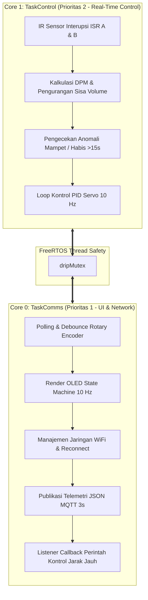

# Smart IV Drip Monitor (Dual-Channel) - Firmware ESP32

[](https://platformio.org/)
[](https://www.espressif.com/en/products/socs/esp32)
[](https://www.freertos.org/)
[](https://mqtt.org/)
[](https://github.com/adafruit/Adafruit-GFX-Library)
[](LICENSE)

**Smart IV Drip Monitor (Monitis)** adalah sistem pemantauan dan kontrol laju tetesan infus medis cerdas berbasis mikrokontroler **ESP32 Dual-Core**. Sistem ini dirancang untuk memantau dan mengendalikan **dua ranjang pasien (Dual-Channel)** sekaligus secara independen dalam satu perangkat, menghadirkan integrasi kendali PID aktuator klem servo, antarmuka layar OLED lokal dengan kendali Rotary Encoder, serta pemantauan jarak jauh berbasis MQTT.

---

## 📌 Daftar Isi
- [Latar Belakang & Fitur Utama](#-fitur-utama)
- [Arsitektur Sistem FreeRTOS](#-arsitektur-sistem-freertos)
- [Skema Rangkaian & Pinout Hardware](#-skema-rangkaian--pinout-hardware)
- [State Machine UI Display (13 Layar)](#-state-machine-ui-display-13-layar)
- [Spesifikasi Komunikasi & Format JSON MQTT](#-spesifikasi-komunikasi--format-json-mqtt)
- [Struktur File Kode Sumber](#-struktur-file-kode-sumber)
- [Panduan Instalasi & Penggunaan](#-panduan-instalasi--penggunaan)
- [Petunjuk Catu Daya (PENTING)](#-petunjuk-catu-daya-penting)

---

## 🚀 Fitur Utama

1. **Dual-Channel Monitoring (1 ESP32 $\rightarrow$ 2 Ranjang Pasien)**:
   - Memantau laju tetesan (**Bed 1** & **Bed 2**) secara simultan dan independen.
   - Perhitungan laju tetesan nyata (**Actual DPM - Drops Per Minute**) menggunakan sensor optik inframerah dengan presisi tinggi.
   - Pelacakan dan kalkulasi sisa volume cairan infus (faktor tetes: 20 tetes/ml).

2. **Kontrol Aktuator Klem Servo Tertutup (PID Controller)**:
   - Algoritma PID (*Proportional-Integral-Derivative*) dengan pencegahan *anti-windup* untuk menjaga stabilitas laju tetesan sesuai target DPM.
   - Rentang sudut klem: $0^\circ$ (klem tertutup rapat / darurat / pause) hingga $180^\circ$ (klem terbuka maksimal).

3. **Proteksi Pasien & Penanganan Alarm Cerdas**:
   - **Deteksi Mampet & Habis**: Jika tidak ada tetesan terdeteksi selama $>15$ detik saat infus aktif, sistem otomatis memicu `SCREEN_ALARM_WARNING` dan menutup klem servo ($0^\circ$).
   - **Status Sensor Independen (`isSensorActive`)**: Sensor dapat dinonaktifkan per-ranjang tanpa memicu alarm palsu (misal saat ranjang sedang kosong).
   - **Smart Alarm Routing**: Menekan tombol rotary encoder saat alarm aktif akan mematikan alarm dan langsung mengarahkan layar ke **Detail Channel** ranjang yang bermasalah.

4. **Antarmuka Pengguna Lokal (13-State OLED Display Engine)**:
   - Mendukung layar OLED 1.3" (driver SH1106) dan 0.96" (driver SSD1306) resolusi $128 \times 64$ piksel via I2C.
   - Navigasi menu intuitif menggunakan 1 unit Rotary Encoder (Putar Kanan/Kiri, Klik Singkat, dan Tekan Tahan $>1$ detik).

5. **Konektivitas IoT Real-Time (WiFi & MQTT)**:
   - Terhubung otomatis ke WiFi dengan mekanisme *auto-reconnect*.
   - Publikasi data telemetri berkala setiap 3 detik dalam format JSON lengkap ke MQTT Broker.
   - Menerima kendali jarak jauh (pengubahan Target DPM, Pause/Resume, dan On/Off Sensor).

---

## 🧠 Arsitektur Sistem FreeRTOS

Firmware memanfaatkan kedua inti prosesor ESP32 (Dual-Core) secara terisolasi untuk mencegah interferensi antara kalkulasi kritis medis dan latensi jaringan:



---

## 🔌 Skema Rangkaian & Pinout Hardware

| Modul / Komponen | Pin Hardware ESP32 | Tipe Pin | Keterangan |
| :--- | :--- | :--- | :--- |
| **Sensor IR Bed 1** | **GPIO 27** | Input (Pull-Up) | Interupsi `FALLING` tetesan infus Ranjang 1 |
| **Servo Klem Bed 1** | **GPIO 18** | Output (PWM) | Kontrol motor servo klem selang Ranjang 1 |
| **Sensor IR Bed 2** | **GPIO 14** | Input (Pull-Up) | Interupsi `FALLING` tetesan infus Ranjang 2 |
| **Servo Klem Bed 2** | **GPIO 19** | Output (PWM) | Kontrol motor servo klem selang Ranjang 2 |
| **Rotary Encoder CLK** | **GPIO 25** | Input (Pull-Up) | Pin Clock encoder dengan interupsi |
| **Rotary Encoder DT** | **GPIO 26** | Input (Pull-Up) | Pin Data arah putaran encoder |
| **Rotary Encoder SW** | **GPIO 32** | Input (Pull-Up) | Tombol tekan (*Push Button*) encoder |
| **OLED Display SDA** | **GPIO 21** | I2C Data | Jalur data I2C layar OLED |
| **OLED Display SCL** | **GPIO 22** | I2C Clock | Jalur clock I2C layar OLED |

---

## 🖥️ State Machine UI Display (13 Layar)

Sistem antarmuka layar OLED terbagi dalam 13 status layar yang dirancang secara ergonomis untuk kebutuhan ruang rawat inap:

```text
[1] SCREEN_STARTUP              -> Splash screen animasi tetesan air medis saat booting
 └──> [2] SCREEN_SUMMARY        -> Dashboard utama perbandingan status Bed 1 & Bed 2
       ├──> [3] SCREEN_DETAIL_A -> Detail & konfigurasi cepat laju tetesan Bed 1
       ├──> [4] SCREEN_DETAIL_B -> Detail & konfigurasi cepat laju tetesan Bed 2
       └──> [5] SCREEN_MAIN_SETTINGS (Tekan tahan encoder 1 detik)
             ├── [6] SCREEN_TARGET_DPM_CONFIG -> Pengaturan presisi target DPM
             ├── [7] SCREEN_VOLUME_CONFIG     -> Pengaturan kapasitas kantong infus (ml)
             ├── [8] SCREEN_NETWORK_STATUS    -> Status IP address, WiFi RSSI, broker MQTT
             ├── [9] SCREEN_SENSOR_DIAGNOSTICS-> Status keaktifan IR & hitungan pulsa fisik
             ├── [10] SCREEN_ALARM_HISTORY    -> Log riwayat 3 insiden alarm terakhir
             ├── [11] SCREEN_SYSTEM_INFO      -> Uptime perangkat, sisa memori Heap, versi
             └── [13] SCREEN_CONFIRMATION     -> Layar notifikasi 'Pengaturan Disimpan!'

[12] SCREEN_ALARM_WARNING       -> Layar darurat otomatis jika terdeteksi mampet / habis
```

### Panduan Kendali Rotary Encoder:
* **Putar Searah / Berlawanan Jarum Jam**: Menggeser pilihan menu atau menaikkan/menurunkan nilai target DPM / volume.
* **Klik Singkat (Short Click)**: Masuk ke submenu, konfirmasi pengaturan, atau *Toggle Pause/Resume* infus.
* **Tekan Tahan (Long Press $>1$ detik)**: Masuk ke Menu Pengaturan Utama dari Dashboard, atau kembali langsung ke Dashboard dari menu mana pun.
* **Klik pada Layar Alarm Warning**: Mematikan status anomali dan membuka langsung layar **Detail Bed** yang bersangkutan.

---

## 🌐 Spesifikasi Komunikasi & Format JSON MQTT

* **Broker Default**: `broker.hivemq.com`
* **Port**: `1883`

### 1. Telemetri Lengkap (ESP32 $\rightarrow$ MQTT)
Dipublikasikan setiap 3 detik ke topik:  
`monitis/telemetry`

```json
{
  "device_id": "MONITIS-ESP32",
  "uptime_sec": 3600,
  "ip": "192.168.1.105",
  "rssi": -62,
  "beds": [
    {
      "bed": 1,
      "target_dpm": 20,
      "actual_dpm": 20,
      "sisa_ml": 448.5,
      "volume_awal_ml": 500.0,
      "persen_sisa": 89.7,
      "paused": false,
      "anomaly": false,
      "sensor_active": true,
      "servo_angle": 90,
      "pulse_count": 1030
    },
    {
      "bed": 2,
      "target_dpm": 15,
      "actual_dpm": 15,
      "sisa_ml": 118.2,
      "volume_awal_ml": 500.0,
      "persen_sisa": 23.6,
      "paused": false,
      "anomaly": false,
      "sensor_active": true,
      "servo_angle": 85,
      "pulse_count": 7636
    }
  ]
}
```

### 2. Perintah Kontrol Jarak Jauh (Aplikasi $\rightarrow$ ESP32)
ESP32 mendengarkan (*subscribe*) topik perintah berikut:
* `monitis/control` (Perintah umum dengan parameter `"bed": 1` atau `2`)
* `monitis/bed1/control` (Khusus Bed 1)
* `monitis/bed2/control` (Khusus Bed 2)

#### Contoh Perintah:
* **Mengubah Target Laju Tetesan:**
  ```json
  { "target_dpm": 28 }
  ```
* **Menjeda / Menghentikan Aliran Infus (Klem Ditutup):**
  ```json
  { "pause": true }
  ```
* **Menonaktifkan Sensor (Misal Bed Kosong / Pergantian Infus):**
  ```json
  { "sensor_active": false }
  ```

---

## 📂 Struktur File Kode Sumber

```text
monitis/
├── include/
│   ├── Config.h         # Definisi pinout, struktur data DripChannel, SSID/MQTT, dan State enum
│   ├── Control.h        # Deklarasi fungsi inisialisasi PID & taskControlCode
│   ├── Comms.h          # Deklarasi fungsi komunikasi WiFi, MQTT, & taskCommsCode
│   ├── Display.h        # Deklarasi fungsi rendering UI 13-layar
│   ├── Sensor.h         # Deklarasi ISR interrupt IR & handler encoder
│   └── SH1106Display.h  # Driver grafis standalone OLED SH1106/SSD1306 (dual-charge pump)
├── src/
│   ├── main.cpp         # Setup sistem, inisialisasi Mutex, dan pembuatan Task FreeRTOS
│   ├── Control.cpp      # Implementasi PID servo, DPM tracker, dan deteksi anomali
│   ├── Comms.cpp        # Implementasi WiFi, PubSubClient MQTT, dan generator JSON
│   ├── Display.cpp      # Implementasi 13 state machine UI dan ikon grafis piksel
│   └── Sensor.cpp       # Rutinitas interupsi optik IR dan debounce encoder
├── platformio.ini       # Konfigurasi board, dependensi library, dan upload port
└── README.md            # Dokumentasi teknis proyek
```

---

## ⚙️ Panduan Instalasi & Penggunaan

### 1. Prasyarat
* Pasang [Visual Studio Code](https://code.visualstudio.com/).
* Pasang ekstensi **PlatformIO IDE** di VS Code.
* Kabel data Micro-USB untuk menghubungkan ESP32 ke komputer.

### 2. Konfigurasi
Buka file [`include/Config.h`](include/Config.h):
* Sesuaikan kredensial WiFi Anda:
  ```cpp
  #define WIFI_SSID "NAMA_WIFI_ANDA"
  #define WIFI_PASS "PASSWORD_WIFI_ANDA"
  ```
* Sesuaikan broker MQTT bila menggunakan server lokal / pribadi:
  ```cpp
  #define MQTT_BROKER "broker.hivemq.com"
  #define MQTT_PORT 1883
  ```
* **Mode Pengujian / Simulasi**:
  - Ubah `#define SIMULATION_MODE false` menjadi `true` jika ingin menguji antarmuka OLED dan komunikasi MQTT tanpa sensor fisik terpasang.

### 3. Kompilasi & Flash Firmware
Jalankan perintah berikut di terminal PlatformIO:
```powershell
# Kompilasi kode sumber
pio run

# Upload firmware ke ESP32
pio run -t upload

# Buka Serial Monitor untuk debugging (115200 baud)
pio run -t monitor
```

---

## ⚠️ Petunjuk Catu Daya (PENTING)

1. **JANGAN Memberi Daya Motor Servo dari Pin 5V/VIN ESP32!**  
   Motor servo (MG90S / SG90) membutuhkan lonjakan arus sesaat (*inrush current*) hingga 500mA - 1A saat bergerak. Menghubungkan 2 buah servo langsung ke pin regulator ESP32 dapat menyebabkan tegangan *drop* dan ESP32 mengalami *Brownout Reset*.
2. **Gunakan Adaptor Eksternal 5V (Minimal 2A - 3A)** khusus untuk jalur daya positif (`VCC`) dan negatif (`GND`) kedua motor servo.
3. **Wajib Common Ground**: Hubungkan kabel `GND` dari adaptor 5V eksternal ke pin `GND` ESP32 agar sinyal referensi PWM stabil.

---

## 📄 Lisensi
Proyek ini dilisensikan di bawah [MIT License](LICENSE) - Hak Cipta © 2026 Tim Pengembang **Monitis** (`arekpelajar-cmd`).  
Bebas digunakan, dimodifikasi, dan didistribusikan untuk keperluan riset medis, kompetisi inovasi teknologi kesehatan, maupun pengembangan sumber terbuka (*Open Source*).
